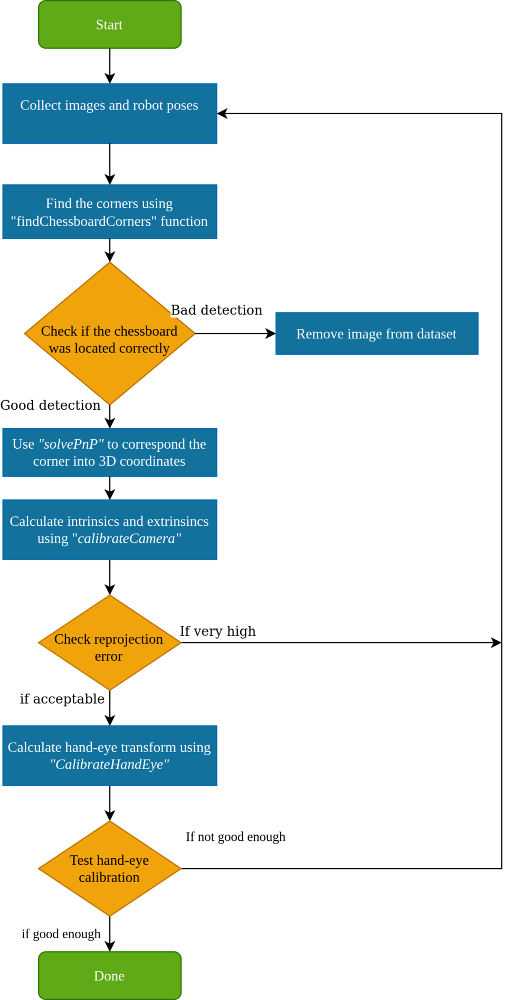

# HandEyeCalibration

**Update, 2026** — Coming back to this after a couple of years, I finally sat down
with issue #1, which had been bugging me since 2023. I went through it with Claude,
and it turned out the argument order I originally passed to `cv2.calibrateHandEye`
solves the mirror-image problem: the calibration itself was always numerically
correct (which is why it matched MATLAB and worked fine on the real robot) — but for
methods 0-3, `T_cam2gripper` and `T_gripper2cam` were being written to each other's
files. That's now fixed, along with a couple of smaller accuracy issues and a
requirements.txt that had picked up dependencies from an unrelated project. Details
below.

**If you're upgrading**: this is a breaking change for methods 0-3. If your code
reads `T_cam2gripper_Method_0.npz` through `T_cam2gripper_Method_3.npz`, what you
were getting back was actually gripper2cam. Re-run the calibration, or swap in the
`T_gripper2cam_*` file instead.

**Requires OpenCV 4.x.** `cv2.calibrateHandEye` and `cv2.calibrateRobotWorldHandEye`
are missing from the OpenCV 5.x Python wheels (the `CALIB_HAND_EYE_*` constants are
still there, just not the function) - `requirements.txt` pins accordingly.

**Recommended method**: Park (method 1). Per
[opencv/opencv#24871](https://github.com/opencv/opencv/issues/24871), Tsai, Horaud,
Andreff and Daniilidis are reported unreliable on some inputs; Tsai in particular is
consistently the outlier on the bundled example dataset.

---

This code is an openCV implementation for Handeye calibration. The implementation is done using this flowchart:




To use this code is contained in HandEyeCalibration_class.py

The file describes a class named CameraCalibration with 2 mandatory inputs and 4 optional ones:

image_folder - a folder containing images of a chessboard. The images should be named color_image_xxx.png where xxx is the image number

Transforms_folder - a folder containing the transforms from the base of the robot to the end effector. The transforms should be named T_base2ee_xxx.npz. where xxx is the number. 
    It is important that the numbers in the transformations and the Images correspond to the same isntance. For example color_image_001 was taken at the same time as T_base2ee_001.npz

pattern_size: the number of corners in the chessboard pattern, default is (4,7)

square_size: the size of the squares in the chessboard pattern, default is 33/1000. 
The units in the transforms and the square size need to be the same!!

ShowProjectError: if True, shows the reprojection error for each image in a bar plot, default is False

ShowCorners: if True, shows the chessboard corners for each image as they're found, default is False

## Conventions

Each `.npz` file in `Transforms_folder` must hold a 4x4 matrix giving **the gripper's
pose expressed in the robot's base frame** - i.e. plain forward kinematics from the
joint angles (see issue #2 for an example using the UR5 DH parameters). This is what
OpenCV's docs call `R_gripper2base` / `t_gripper2base`. The legacy folder/file naming
here (`T_base2ee`) reads like the opposite direction - what matters is the content,
not the name.

Output:
The class outputs 14 files in `FinalTransforms/`: for each of the 7 hand-eye methods
(5 from `calibrateHandEye`, 2 from `calibrateRobotWorldHandEye`), both directions are
saved - `T_cam2gripper_Method_N.npz` and `T_gripper2cam_Method_N.npz`. It also writes
`FinalTransforms/residuals.txt`, ranking each method by how consistent its result is
across the input poses (a self-check you can run without a robot - see issue #10) -
and saves the images with detected corners to `DetectedCorners/` for verification.


An example is included in the folder Cal2 and within the HandEyeCalibration_class.py

## Installation

1. Clone this repository:
```bash
git clone https://github.com/JonesCVBS/HandEyeCalibration-using-OpenCV.git
```

2.Change directory to the cloned repository:

```bash
cd HandEyeCalibration-using-OpenCV
```

3.Install the required dependencies using the requirements.txt file:

```bash
pip install -r requirements.txt
```
